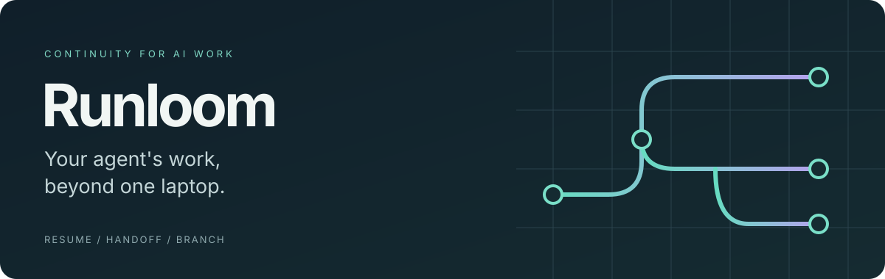
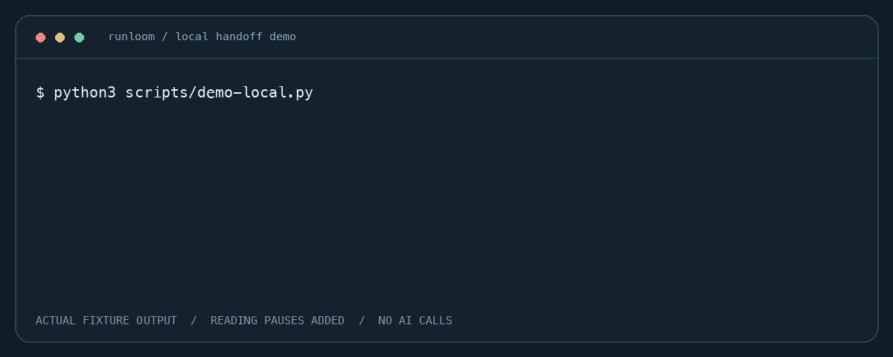
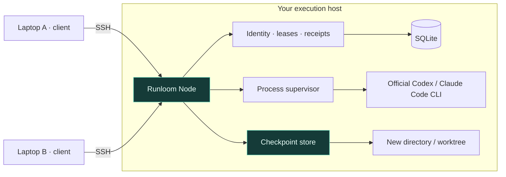
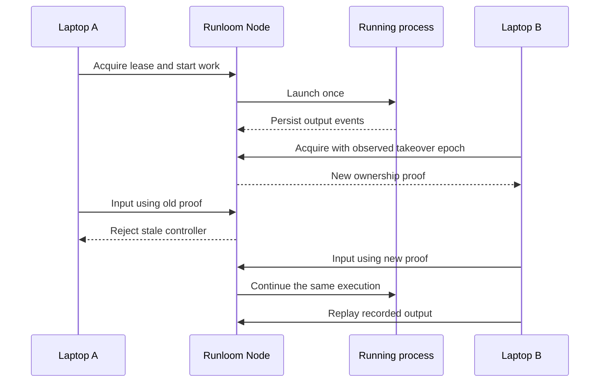

<p align="center">
  
</p>

<p align="center">
  <a href="LICENSE"></a>
  
  
  
</p>

<p align="center">
  <strong>Keep AI work on your host. Pick it up from another device.</strong><br>
  Resume a session, transfer control, or explore a new branch from a checkpoint.
</p>

<p align="center">
  <a href="#see-it-work">Demo</a> · <a href="#try-it-locally">Quick start</a> · <a href="#how-it-fits-together">Architecture</a> · <a href="docs/USAGE.md">Usage</a> · <a href="docs/ROADMAP.md">Roadmap</a>
</p>

## Why Runloom?

Your agent is working on a project. You move to another laptop. The process, conversation and files should still have a clear home—and only the current controller should be able to send commands.

Runloom connects **session identity, execution ownership and code checkpoints** on an execution host. It uses installed official Codex or Claude Code tools, with a Rust core and a private node protocol.

| You want to… | Runloom provides |
| --- | --- |
| Return to an existing conversation | Explicit provider, profile and native session identity |
| Switch controllers | Server-checked leases; stale controllers lose write access |
| Catch up after reconnecting | Recorded process output and request receipts |
| Save a point to return to | Git/file checkpoints and selected native history |
| Explore another direction | Independent worktree and supported native conversation branch |
| Hand an agent a specification | Explicitly started Claude CLI tasks with acceptance criteria |

## See it work



*Actual output from `scripts/demo-local.py`, rendered as a terminal animation with reading pauses. Two controllers are simulated locally; this is not a desktop UI recording or physical-device acceptance test. [Plain-text transcript](docs/assets/demo-output.txt) · [Static image](docs/assets/demo.png)*

The demo starts one real fixture process, changes its controller, rejects the old controller's input, and restores a saved working file into a new directory. No AI account, SSH or sudo is needed.

## Try it locally

From the repository root, on macOS with **Rust/Cargo 1.91+**, **Git**, **Python 3.9+** and a **C toolchain**:

```sh
cargo build --workspace --locked
python3 scripts/demo-local.py
```

The demo uses disposable files and does not touch existing sessions. To run a foreground node and connect over SSH, follow the [step-by-step guide](docs/USAGE.md).

## How it fits together



The host owns processes and files. Clients connect through a private Unix socket or SSH bridge. Provider credentials stay on the execution host. Desktop UI, character animation and voice can be built as clients; they are not included in this repository.

### One execution, a new controller



A lost connection does not mean a mutation was cancelled. Receipts and explicit ownership checks help clients handle uncertain delivery; Runloom does not promise exactly-once external side effects.

## What this preview includes

**Available:** Rust core, CLI, node protocol, supervisors, leases, PTY, provider continuation adapters, checkpoint restore, conversation/worktree branching and task dispatch.

**Validated locally:** 27 Rust tests and ten offline demo/integration scripts passed for the initial preview. These cover fixture execution, stale ownership, output replay, checkpoint contention and branching. See [CONTRIBUTING](CONTRIBUTING.md) to reproduce the checks. Hosted CI has not yet run.

**Still to validate:** clean-machine installation, physical-device handoff, reboot recovery and fresh authenticated provider compatibility. Other operating systems are not certified. Package version `0.1.0` is a development version, not stable acceptance.

<details>
<summary><strong>Operational boundaries worth knowing</strong></summary>

- The trust boundary is the OS account and SSH access. Workspace labels do not isolate hostile tenants.
- A node is not a sandbox. Official tools retain their authentication and approval behavior.
- Unknown process state and interrupted directory reservations require inspection; no automatic replay or reservation expiry is provided.
- Schema v4 needs a stopped-process backup before upgrade; in-place downgrade is unsupported.
- Checkpoints may contain secrets in source or conversation text. Filename exclusions are not general secret removal.
- Conversation branches use supported native formats. They do not reconstruct hidden model reasoning or merge conversations across providers.

Read the [security model](SECURITY.md) and [architecture](docs/ARCHITECTURE.md) before using real work.

</details>

## Go deeper

| Document | Start here for… |
| --- | --- |
| [Usage](docs/USAGE.md) | Foreground startup, SSH, requests, resume and restore |
| [Architecture](docs/ARCHITECTURE.md) | Identity, persistence, fencing and extension seams |
| [Roadmap](docs/ROADMAP.md) | Preview, stable release and longer-term product goals |
| [Contributing](CONTRIBUTING.md) | Build commands and regression checks |
| [AGENTS.md](AGENTS.md) | Context and invariants for your coding agent |
| [Security](SECURITY.md) | Trust boundaries and private reporting setup |

## License

Runloom is [MIT licensed](LICENSE). Dependencies retain their own licenses; see [third-party notices](THIRD_PARTY_NOTICES.md). The source package excludes private deployment history, credentials, desktop clients and character/voice assets.
