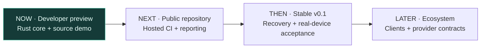

# Roadmap

**Current stage: locally validated developer preview.** Updated 2026-11-06.

Statuses describe evidence, not elapsed effort: **Done locally** means repeatable fixture validation; **Next** is an acceptance gate; **Planned** is not implemented or promised on a date. We do not assign a percentage to the product roadmap.

## Short term — make the preview inspectable

| State | Deliverable | Acceptance evidence |
| --- | --- | --- |
| Done locally | MIT source export and private-history separation | Independent repository, allowlist and per-file SHA-256 manifest |
| Done locally | Core ownership, checkpoints and branches | Rust tests and offline process/integration fixtures |
| Done locally | Review and concurrency repairs | Independent code/security re-review; regression fixtures |
| Done locally | Demonstration and contributor docs | Runnable demo, Mermaid diagrams, usage and AI handoff guide |
| Done locally | Versioned alpha packaging | Version/tag checks, checksums and isolated-HOME installer fixture; see [release guide](RELEASE.md) |
| Next | Publish the intended GitHub repository | Owner uploads clean history; hosted checks pass |
| Next | Private vulnerability reporting | Repository Security tab verified |
| Done locally | Measured quality baseline | Rust-test and combined-fixture line coverage; explicit scope and reproducible commands |

## Immediate priority — explicit recovery

1. **Done locally:** read-only recovery inspection, scoped evidence, bounded responses and no hidden unlock/replay. See [RECOVERY](RECOVERY.md).
2. **Done locally:** advisory recovery plans with ordered investigation steps, explicit scope limits, capability negotiation and a CLI reader. No apply operation or liveness claim.
3. **Next:** record operation ownership/generation and distinguish a live worker from an orphan or unverifiable state.
4. **Next:** apply an explicit resolution with current authority, a final safety recheck, audit events and fault-injection tests.

This milestone should precede more UI or additional providers. Its first diagnostic slice is ready for the developer preview; full repair remains unfinished.

## Medium term — earn stable v0.1

These are release gates, not claims that the current preview already meets them.

- [ ] **Recover uncertain operations:** inspect/reconcile interrupted reservations and processes without blindly replaying side effects; test every recovery decision.
- [ ] **Physical handoff:** laptop A disconnects/closes, host work continues, laptop B takes control; stale A input is rejected.
- [ ] **Host reboot:** report accepted/running/interrupted work accurately; no accidental duplicate task execution.
- [ ] **Clean-machine lifecycle:** install, upgrade, migration/backup and uninstall on a fresh account; verify ownership and permission boundaries.
- [ ] **Provider compatibility:** publish a versioned Codex/Claude adapter matrix with fresh authenticated disposable-session continuation and branch tests.
- [ ] **Failure-focused coverage:** extend tests for low-covered CLI/node paths, error handling, input uncertainty and recovery; track line coverage without treating it as proof of correctness.

Schema v4 requires a stopped-process backup before upgrade; in-place downgrade is unsupported. Physical-device tests and provider inference must be recorded separately from offline fixtures.

## Long term — a reusable continuity layer

| Direction | First useful outcome |
| --- | --- |
| Stable client protocol | Capability/version negotiation and documented errors for independent clients |
| Phone and companion clients | Explicit remote approvals and ownership, with visible execution status |
| Session history interoperability | Evaluate checkpoint/session formats before adding import/export adapters |
| Remote object storage | A clear privacy and sharing policy with verified checkpoint integrity |
| Wider platform support | Platform-specific process, PTY and filesystem acceptance suites |

[Related-project research](RELATED-PROJECTS.md) informs these priorities. Happy, HAPI, Entire and Conductor already cover substantial adjacent workflows; a smaller core must demonstrate integration value and recovery reliability.

Multi-tenant isolation and a cloud scheduler would need a separate security design. They are not implied by workspace labels or this roadmap. No date or production-readiness guarantee is implied by the package version.
